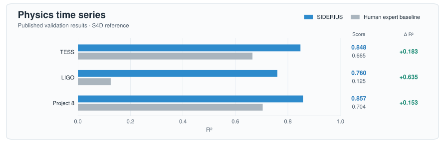
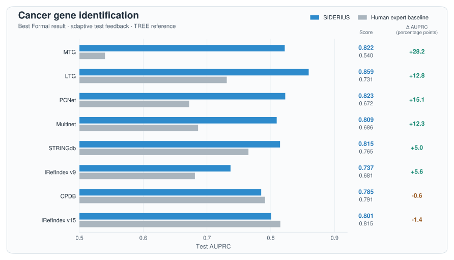
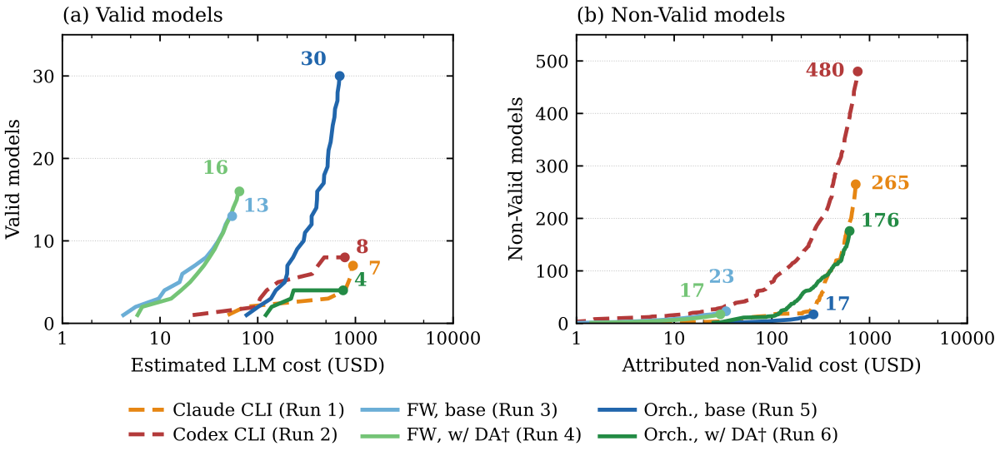
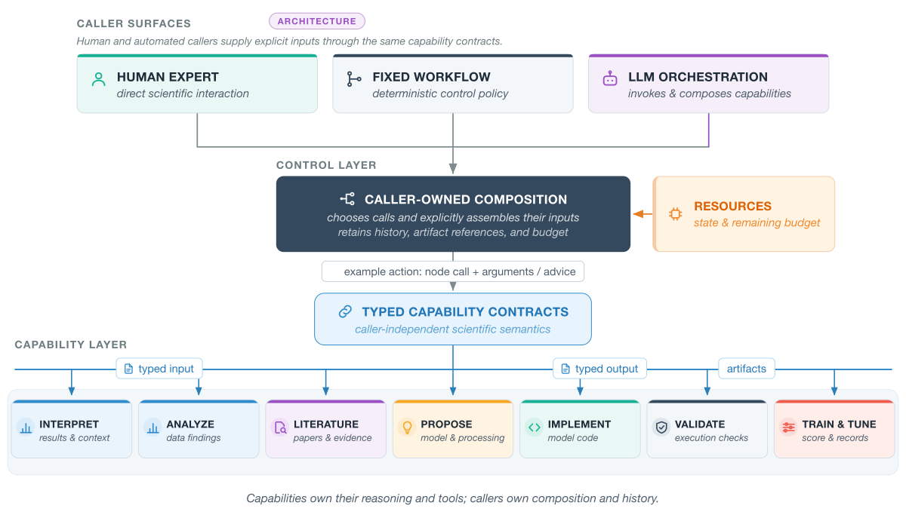
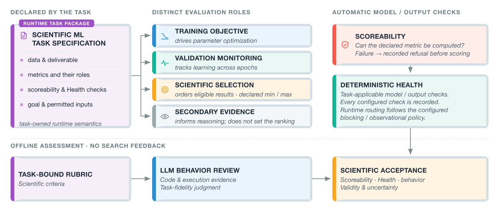

<p align="center">
  <a href="https://siderius.scitra.org">
    <picture>
      <source media="(prefers-color-scheme: dark)" srcset="src/tools/candidate_console/static/siderius-logo-dark.svg">
      
    </picture>
  </a>
</p>

<p align="center">
  <a href="https://siderius.scitra.org"><b>Website</b></a> ·
  <a href="https://siderius.scitra.org/getting-started">Getting started</a> ·
  <a href="https://siderius.scitra.org/tutorials">Tutorials</a> ·
  <a href="https://siderius.scitra.org/docs">Documentation</a> ·
  <a href="https://siderius.scitra.org/case-studies">Case studies</a> ·
  <a href="https://arxiv.org/abs/2610.14024">Paper</a>
</p>

# SIDERIUS

**S**cientific **I**nquiry, **D**esign, **E**xploration, and **R**easoning
**I**ntegrated **U**sing multi-agent **S**ystems

**Turn your dataset and research question into an iterative ML experiment.**
Work with your coding agent to define the task and write the experiment as a
short Python workflow file; SIDERIUS then helps propose models, implement them,
train and evaluate them, and use the results to guide the next iteration.





Sources: [SIDERIUS paper (arXiv:2610.14024)](https://arxiv.org/abs/2610.14024) ·
[TREE paper](https://doi.org/10.1038/s41551-024-01312-5) ·
[Comparison data and evaluation conditions](docs/assets/results/provenance.md).

- **Run an experiment cycle:** go from a hypothesis to model code, measured results
  and the next experiment, with a record of each iteration.
- **Evaluate more than a score:** declare task-specific validity checks alongside
  your metric, with controlled data access and reproducible evaluation rules.
- **Choose how to explore:** start with a lightweight fixed workflow or let an
  LLM orchestrator (your coding agent) compose research steps. Select models independently by role.

Step-by-step tutorials, guides and case studies are on the
[SIDERIUS website](https://siderius.scitra.org). This README covers what
SIDERIUS is, installation and how to start with your coding agent.

See [supported providers and models](docs/reference/model-qualification.md) for
required model capabilities and the configurations tested so far.

<a id="start-with-your-coding-agent"></a>

## Quick start with your coding agent

Before you start, you need:

- **Python 3.12+ and uv.** After installation, use this checkout's own
  `.venv/bin/python`.
- **Your dataset location** and a **project folder outside this checkout** for
  your task, settings and results.
- **An NVIDIA GPU with CUDA** on the machine that runs training. There is no
  CPU mode: a run that trains a model on a machine without one is refused before
  any model call. Setup checks and the synthetic Quickstart checks run on CPU.
- **Provider API keys** for real model calls (offline setup checks need none).
  The command line and the experimental browser console read keys from
  different places; see [API keys](docs/getting-started/installation.md#api-keys).
- **bubblewrap**, the Linux sandbox that preparing and running a workflow use.
  Run the [bubblewrap check](src/tools/workspace_sandbox/README.md#check-that-bubblewrap-works)
  once on that machine.

Clone the repository and install it:

```bash
git clone https://github.com/yuema137/SIDERIUS.git
cd SIDERIUS
uv sync --group dev --frozen
```

Then open the checkout in your coding agent (for example Claude Code or Codex).
[Getting started](docs/getting-started/README.md) gives the ordered setup, where
to put credentials, and every command that prepares, runs and reads a workflow.

### What an experiment is made of

Your agent writes a few ordinary files in your project folder. You can read
every setting before anything runs:

1. **Task package** (`task.yaml` and the plugins it names): the science. It
   says how to read your data, how it is split, what a model reads and
   produces, the main score, and the Health checks that decide whether a model
   is valid. See [what a task package contains](docs/concepts/task-package.md).
2. **Workflow declaration** (`workflow.py`): the experiment. It lists the
   research steps that run (for example Propose → Implement → Validate →
   Train & tune), how results pass between them, your advice to each step,
   training budgets and, for a research loop, its iteration limit and stop
   conditions. [How a workflow is built](examples/workflow_declarations/README.md#how-a-workflowpy-is-built)
   walks through a real one.
3. **LLM profile** (`llm.json`): which model and provider serve each role.
4. **Preparation request** (`reusable-request.json`): the run's own settings:
   which `workflow.py` and `llm.json` to use, where results go, time limits,
   GPU devices, network access and the *names* of the provider keys.

`.venv/bin/python -m tools.candidate_prepare` reads the preparation request and
captures exactly what will run, offline. `.venv/bin/python -m tools.candidate_operations submit`
launches it only when you say so; the same tool reports status and logs, and
stops, pauses or resumes a research loop between iterations. With
orchestration (next section), a caller script and its sandbox settings take the
place of `workflow.py` and the preparation request.

### Choose the execution: workflow or orchestration

The task package is the same either way. What changes is **who decides the
next research step**:

| Execution | Who decides the next step | When to choose it |
| --- | --- | --- |
| **Workflow: lightweight starting point** | You do, in advance. `workflow.py` declares the steps and the loop; SIDERIUS executes that path without an extra LLM deciding each call. | You know the research loop you want, and you want predictable cost and a recorded, repeatable path. |
| **Orchestration: flexible exploration** | Your coding agent does, at run time. Following the SIDERIUS toolkit installed in your project, it invokes research capabilities through a caller script it writes and runs (`scripts/caller.py`), and chooses each next call from the evidence so far. | You want the research process itself to adapt beyond a fixed sequence, and accept more setup and potentially higher LLM cost. |

In both, the deterministic core still owns data access, training, scoring and
Health. `llm.json` selects the models *inside* each capability; the
orchestrator (your coding agent) uses its own model. To set up
orchestration, follow the [orchestration setup guide](src/tools/orchestration_setup/README.md).

**Workflow keeps coordination lightweight; orchestration offers more room to
adapt the research process.** In the paper's TIDMAD comparison, fixed workflows
had the lowest estimated LLM cost, while orchestration without the Data
Analysis step (an agent that runs analysis code on your data) produced the most
valid models and the best valid score. This demonstrates its potential, not a
guarantee that orchestration wins on every task.

[](docs/assets/paper/figure3.svg)

**Figure 3. Exploration and LLM cost on TIDMAD.** The left panel counts valid
models; the right counts non-valid models. Costs are estimates and exclude GPU
training. See the [paper](https://arxiv.org/abs/2610.14024) for the experimental
conditions.

### Choose how you work with your agent: Professional or Assistant

**Professional and Assistant are the main ways to use SIDERIUS 1.1.** Both
start with a short request to your coding agent. They describe how you
collaborate, not software modes: both produce the same files and use the same
commands, and both can use a workflow or orchestration. You can also write
every file by hand.

| Way of working | Who leads? |
| --- | --- |
| **Professional** | You choose the research plan; your agent helps implement it. |
| **Assistant** | You describe the problem; your agent guides you through the choices. |

#### Professional: bring your plan

With a workflow, paste:

```text
Use SIDERIUS in Professional style. My MNIST images and labels are in /data/mnist.
Build a digit-classification task package in ~/mnist-research, then write the
experiment as a workflow declaration ~/mnist-research/workflow.py: the interpreted
training workflow as a research loop of at most three iterations. Keep the test
split out of search feedback; optimize validation accuracy. Help me set model
routing, training budgets and stop conditions, then show me workflow.py, the
LLM profile, the preparation request and the result paths before preparing
or launching anything.
```

With orchestration, paste instead:

```text
Use SIDERIUS in Professional style with orchestration. My MNIST images and labels
are in /data/mnist. Build a digit-classification task package in ~/mnist-research.
Keep the test split out of search feedback; optimize validation accuracy. Then set
up orchestration in that project and its sandbox so you can choose which SIDERIUS
capabilities to call and when, within the data-access rules and budgets we agree
on. Show me the task package, the LLM profile, the sandbox settings and the caller
before running anything.
```

#### Assistant: describe your problem

Paste:

```text
Use SIDERIUS in Assistant style. I have MNIST images and labels in /data/mnist;
help me build and evaluate a digit classifier. Follow this repository's setup
guidance, help me choose workflow or orchestration, and prepare an external
project with the environment, task package, workflow declaration (workflow.py)
and the commands to prepare and run it.
```

Your agent follows the [setup guidance](docs/agent-reference/siderius-setup-review/SKILL.md):
it inspects your data and hardware, helps agree on splits and metrics, prepares
the environment and API-key setup, and saves the task and experiment in your own
project. It shows the exact launch command and where to find results.
No global skill installation is needed.

Replace the example data and project paths with your own. In either style,
you control the scientific choices and paid execution; the agent asks about
missing decisions before launching. A [configuration review and HTML report](src/tools/setup_review/README.md)
is optional. An experimental browser console can also show and run the same
files; see [below](#try-the-browser-console-experimental).

### Choose models by role

Every workflow run names an LLM profile: the preparation request's
`llm_config_file` must point at one, and preparation refuses a request without
it. For a first flow check, copy [`default.json`](configs/llm/default.json)
into your project as `llm.json`. It uses **GPT-5.6 Luna for every role**, with
`medium` reasoning and one transport attempt per call (no automatic retry after
a 429/5xx response). Start with a small flow check; stronger models are an
explicit choice. (The older chain launcher, `scripts/launch/run_chain.sh`, uses
the same Luna routing automatically when you pass no `--llm_config`.)

**For research runs, we recommend
[`openai-moderate-v1.json`](configs/llm/openai-moderate-v1.json).** It uses
`gpt-6-astra` for all three proposer stages and the validator, and
`gpt-5.6-luna` for the other workflow roles, all with `medium` reasoning.

You can choose a supported model and provider independently for each role:
allocate stronger models to proposal and validation and lighter models
elsewhere, then adjust individual roles for your task and budget without
changing `workflow.py`. Your coding agent's own model is a separate choice. The
[configuration guide](configs/llm/README.md) shows how to copy a profile into
your project and select it on each route. Model selection does not set a
spending limit or guarantee better scores; paper replay keeps its
[recorded experiment configurations](https://github.com/yuema137/siderius-exp).

### How to tell a run worked

A run that finishes has not necessarily produced a valid model: compare runs
on the best valid Formal score, and only a scoreable model that passed every
Blocking Health check in a run declared Scientific counts.
[Read the result](docs/getting-started/README.md#6-read-the-result) gives the
full rule and shows where the score and Health verdict appear, on the command
line and in the browser console.

## Try the browser console (experimental)

The browser console is **experimental** in SIDERIUS 1.1. It is useful for
seeing every step once on a small example, and it can open, edit and run a
workflow file, but its screens and settings may change between releases. Use
the coding-agent route above for your research runs, and check the saved
`workflow.py` rather than the screen when you need to know exactly what runs.

The console path has two stages, written out command by command, with the
output to expect, in the
[console first-hour path](docs/getting-started/README.md#your-first-hour-from-the-example-to-your-own-task):

1. **Run the example.** Install, get the example bundle, create a console
   workspace with `init --credential-file`, write the example data, register it
   with `add-task --from-bundle`, start the console with `serve` and open it.
   Then follow the tabs **Task → Workflow → Run → Monitor**.
2. **Bring your own task.** Package your task with your coding agent, place it in
   `siderius_workspace/tasks/<id>/`, register it with `add-task`, restart the
   console, build a workflow for it and run it.

The console needs a Linux machine with an NVIDIA GPU and bubblewrap; the
first-hour path lists the [prerequisites](docs/getting-started/README.md#before-you-start)
and defines its three terms: task, experiment setup and run.

## Try an existing task with siderius-exp

This repository provides the framework. Its companion,
[`siderius-exp`](https://github.com/yuema137/siderius-exp), provides scientific
task packages, experiment configurations, launch scripts, and tutorials.
**Start with the [tutorial guide](https://github.com/yuema137/siderius-exp/blob/main/tutorials/README.md)**
to learn the full path from editing a task to plotting score versus iteration.

The guide offers four notebook demos: **TESS** (stellar rotation), **TIDMAD**
(waveform denoising, one band), **Project8** (electron energy from time and
frequency inputs), and **LIGO** (chirp mass from two detector channels).
Each quick demo runs three research iterations. These are workflow demos,
not reproductions of the paper's artifacts or scores.

Follow the [installation and setup guide](https://github.com/yuema137/siderius-exp/blob/main/tutorials/paper/README.md)
for compatible repository revisions, data, NVIDIA GPU requirements, and API
keys. Work in your own external project directory: the copied notebook explains
and saves your task package and experiment settings, then invokes a saved
script to launch the run. Configurations, scripts, results, and plots stay in
that project; keep credentials outside both source repositories. The notebooks
show how to inspect the saved files and adjust iterations, data fractions,
splits, and time/VRAM budgets before running again. Real runs use GPU resources
and incur API charges.

<a id="paper"></a>

## Paper and architecture

Read [Beyond a Better Score: Long-Horizon Agentic ML Development and Evaluation Protocol for Physics Time Series](https://arxiv.org/abs/2610.14024).
The paper studies scientifically valid model development on TIDMAD, TESS,
Project8 and LIGO, combining composable research capabilities, scientific
checks and exploration within compute budgets.

### How the pieces fit together

[](docs/assets/paper/figure1.svg)

**Figure 1. Infrastructure.** A human scientist, a fixed workflow, or an LLM
orchestrator can call the same scientific capabilities through typed contracts.
The caller chooses the calls, assembles their inputs, and owns control and
history. Each capability owns its reasoning and tools, including executable
Data Analysis.

[](docs/assets/paper/figure2.svg)

**Figure 2. Evaluation.** The task package separates training objectives,
validation monitoring, scientific ranking, and supporting evidence.
Scoreability checks whether the declared metric can be computed; Health
records applicable model/output checks and follows their configured policy:
**Blocking** (a failure invalidates the model) or **Recording** (the result is
only stored). Offline behavioral review adds evidence for scientific
acceptance without feeding its judgments back into search.

These figures are exported from the [paper on arXiv](https://arxiv.org/abs/2610.14024).
Their source and export details are recorded in
[`docs/assets/paper/README.md`](docs/assets/paper/README.md).

<a id="quickstart"></a>

## Check your installation

To check a framework installation without credentials, GPU work or external
data, use the [synthetic Quickstart](examples/quickstart/README.md). It shows
how one small task supplies data access, a model contract and an accuracy metric.
From the checkout you installed above:

```bash
.venv/bin/python -m pytest \
  tests/unit/examples/test_quickstart_pack.py::test_composition_authority_resolves_from_this_checkout \
  tests/unit/examples/test_quickstart_pack.py::test_shipped_manifest_composes_with_the_declared_values -q
```

Success: the last line reads `2 passed` and the exit status is 0.

A real run needs a task package, external data, an LLM profile, a folder for
results and an NVIDIA GPU with CUDA. Preparing a workflow
(`.venv/bin/python -m tools.candidate_prepare`) is offline: it captures exactly
what will run so you can review it, but it does not prove that your provider
account works or that training will succeed. (The older chain launcher,
`scripts/launch/run_chain.sh`, has its own `--dry-run` preview with the same
limit.) The [getting-started guide](docs/getting-started/README.md) leads to the
exact setup and first-run references.

## What you choose

Each choice lives in one file in your project folder. Change the file, not the
framework source.

| Choice | What it controls | File |
| --- | --- | --- |
| Task package | Data meaning and splits, model input/output, training objective, main score and other metrics, Health checks | `task.yaml` and the plugins and declarations it names |
| Workflow | Which research steps run, what evidence passes between them, advice to each step, the iteration limit and stop conditions of a research loop, tuning rounds per iteration, Trial/Formal settings, training budgets, Health enforcement and result standing (Scientific or Diagnostic) | `workflow.py` |
| Models | Provider and model for each role | `llm.json` (the LLM profile) |
| Run settings | Which `workflow.py` and `llm.json` to use, runs folder, preparation and run time limits, GPU devices, network access, folders the run may read, provider key *names* | `reusable-request.json` (the preparation request) |
| Operations store | Where prepared runs may live and where launch records are kept | `store.json` |
| Workspace | Where the run records its identity, generated models and results | Created by preparation: one folder per run under your runs folder |

For example, changing the metric changes the task's scientific meaning.
Giving the same task more search time changes the experiment. Keep both choices
explicit so recorded results can be interpreted and compared. A workspace
records the settings that define its results (task, data scope, Health policy
and workflow) when it starts. To change any of them on purpose, start a fresh
workspace; resuming an existing one keeps its recorded inputs and refuses a
changed setting.

## Find the right part

| Need | Start here |
| --- | --- |
| Learn, configure or operate SIDERIUS | [Documentation](docs/README.md) |
| Try framework contracts on synthetic data | [Examples](examples/README.md) |
| Find a research capability or execution owner | [Source map](src/README.md) |
| Choose policy or provider routing | [Configuration](configs/README.md) |
| Prepare, launch and follow a run | [Getting started](docs/getting-started/README.md#write-and-run-a-workflow-declaration) |
| Find the older chain launcher, Slurm and diagnostic scripts | [Scripts](scripts/README.md) |
| Contribute a change | [Contribution reference](CONTRIBUTING.md), [tests](tests/README.md) |

Repository standards are owned by [CLAUDE.md](CLAUDE.md). Scientific packages,
campaigns and historical paper evidence are owned by
[siderius-exp](https://github.com/yuema137/siderius-exp), which pins its compatible
framework revision independently of this repository's latest development head.

## License

Original SIDERIUS software and documentation are available under the
[MIT License](LICENSE). Third-party portions retain their own terms and
attribution; see [NOTICE](NOTICE). External datasets and dependencies have
separate licenses. This repository's license does not replace them.
