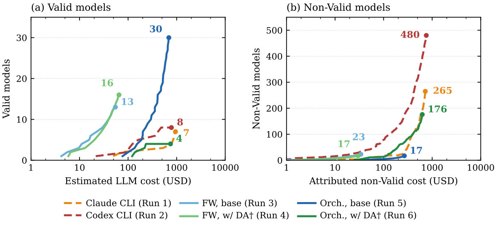
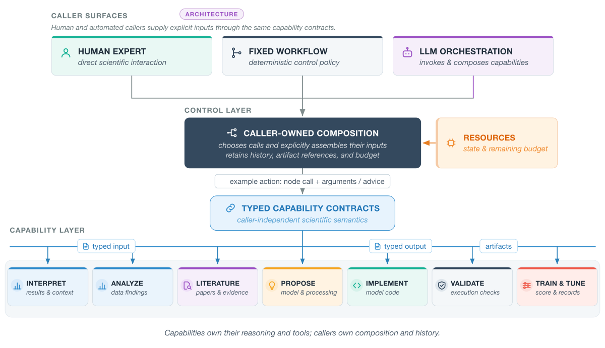
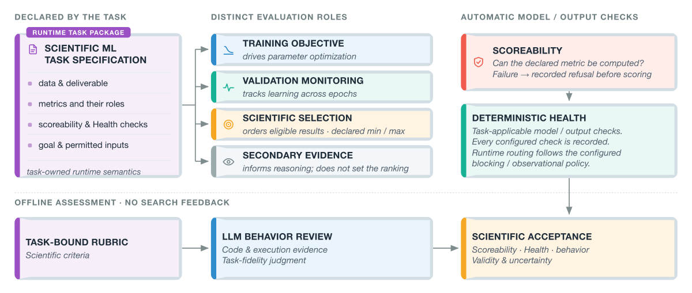

# SIDERIUS

**S**cientific **I**nquiry, **D**esign, **E**xploration, and **R**easoning
**I**ntegrated **U**sing multi-agent **S**ystems

**Turn your dataset and research question into an iterative ML experiment.**
Work with your coding agent to define the task; SIDERIUS then helps propose
models, implement them, train and evaluate them, and use the results to guide
the next attempt.

- **Run a research loop:** go from a hypothesis to model code, measured results
  and the next experiment, with a record of each attempt.
- **Evaluate more than a score:** declare task-specific validity checks alongside
  your metric, with controlled data access and reproducible evaluation rules.
- **Choose how to explore:** start with a lightweight fixed workflow or let an
  LLM orchestrator compose research steps. Select models independently by role.

<a id="start-with-your-coding-agent"></a>

## Quick start with your coding agent

Clone the repository and open it in your coding agent:

```bash
git clone https://github.com/yuema137/SIDERIUS.git
cd SIDERIUS
```

**Both Professional and Assistant start with a short request.** They describe
how you collaborate with your coding agent, not software mode switches.
You can also prepare everything by hand.

| Way of working | Who leads? |
| --- | --- |
| **Professional** | You choose the research plan; your agent helps implement it. |
| **Assistant** | You describe the problem; your agent guides you through the choices. |

### Professional: bring your plan

For a lightweight fixed workflow, paste:

```text
Use SIDERIUS in Professional style. My MNIST images and labels are in /data/mnist.
Build a digit-classification task and a three-iteration fixed-workflow experiment
in ~/mnist-research. Keep the test split out of search feedback; optimize validation
accuracy. Help me set model routing and GPU/time budgets, then show me the saved
configuration, launch script and result paths before running.
```

For orchestration, replace the execution request with:

```text
Use orchestration instead of the fixed workflow. Set up the external project and
sandbox so my agent can choose which SIDERIUS capabilities to call and when,
within the data-access rules and budgets we agree on.
```

You do not need to write configuration files first. Your agent can turn your
plan into a [task package](docs/reference/task-composition.md) and experiment.

### Assistant: describe your problem

Paste:

```text
Use SIDERIUS in Assistant style. I have MNIST images and labels in /data/mnist;
help me build and evaluate a digit classifier. Follow this repository's setup
guidance, help me choose workflow or orchestration, and prepare an external
project with the environment, task, experiment and launch script.
```

Your agent follows the [setup guidance](docs/agent-reference/siderius-setup-review/SKILL.md):
it inspects your data and hardware, helps agree on splits and metrics, prepares
the environment and API-key setup, and saves the task and experiment in your own
project. It shows the exact launch command and where to find results.
No global skill installation is needed.

Replace the example data and project paths with your own. In either style,
you control the scientific choices and paid execution; the agent asks about
missing decisions before launching. A [configuration review and HTML report](src/tools/setup_review/README.md)
is optional. See [getting started](docs/getting-started/README.md) for installation
and detailed setup.

### Choose the execution: workflow or orchestration

Either collaboration style can use either execution approach:

| Execution | What happens | When to choose it |
| --- | --- | --- |
| **Fixed workflow — lightweight starting point** | Research capabilities run in a predefined sequence, without an extra LLM deciding each next call. | Start quickly with lower coordination overhead and a predictable research loop. |
| **Orchestration — flexible exploration** | An LLM caller chooses and combines capabilities as evidence arrives. | Explore beyond a fixed sequence, with more setup and potentially higher LLM cost. |

**Workflow keeps coordination lightweight; orchestration offers more room to
adapt the research process.** In the paper's TIDMAD comparison, fixed workflows
had the lowest estimated LLM cost, while orchestration without Data Analysis
produced the most valid models and the best valid score. This demonstrates its
potential, not a guarantee that orchestration wins on every task.

[](docs/assets/paper/figure3.svg)

**Figure 3 — Exploration and LLM cost on TIDMAD.** The left panel counts valid
models; the right counts non-valid models. Costs are estimates and exclude GPU
training. See the [paper](https://zenodo.org/records/23071121) for the experimental
conditions, or the [orchestration setup guide](src/tools/orchestration_setup/README.md)
to prepare your own caller and sandbox.

### Choose models by role

For a first flow check, use the [Luna test profile](configs/llm/openai_smoke_luna.json).
Your coding agent’s own model and the models called inside the experiment are
separate choices.

**For research runs, we recommend
[`openai-moderate-v1.json`](configs/llm/openai-moderate-v1.json).** It uses
`gpt-6-astra` for all three proposer stages and the validator, and
`gpt-5.6-luna` for the other workflow roles, all with `medium` reasoning.

SIDERIUS lets you choose a supported model and provider independently for each
role. You can allocate stronger models to proposal and validation while using
lighter models elsewhere, then adjust individual roles for your task and budget
without changing the workflow code. See the [configuration guide](configs/llm/README.md)
to copy a profile into your project and select it at launch. Model selection does
not set a spending limit or guarantee better scores; paper replay keeps its
[recorded experiment configurations](https://github.com/yuema137/siderius-exp).

## Try an existing task with siderius-exp

This repository provides the framework. Its companion,
[`siderius-exp`](https://github.com/yuema137/siderius-exp), provides scientific
task packages, experiment configurations, launch scripts, and tutorials.
**Start with the [tutorial guide](https://github.com/yuema137/siderius-exp/blob/main/tutorials/README.md)**
to learn the full path from editing a task to plotting score versus iteration.

The guide offers four notebook demos: **TESS** (stellar rotation), **TIDMAD**
(waveform denoising, one band), **Project8** (electron energy from time and
frequency inputs), and **LIGO** (chirp mass from two detector channels).
Each quick demo runs three research iterations. These are workflow demos,
not reproductions of the paper's artifacts or scores.

Follow the [installation and setup guide](https://github.com/yuema137/siderius-exp/blob/main/tutorials/paper/README.md)
for compatible repository revisions, data, NVIDIA GPU requirements, and API
keys. Work in your own external project directory: the copied notebook explains
and saves your task package and experiment settings, then invokes a saved
script to launch the run. Configurations, scripts, results, and plots stay in
that project; keep credentials outside both source repositories. The notebooks
show how to inspect the saved files and adjust iterations, data fractions,
splits, and time/VRAM budgets before running again. Real runs use GPU resources
and incur API charges.

<a id="paper"></a>

## Paper and architecture

Read [Beyond a Better Score: Long-Horizon Agentic ML Development and Evaluation Protocol for Physics Time Series](https://zenodo.org/records/23071121).
The paper studies scientifically valid model development on TIDMAD, TESS,
Project8 and LIGO, combining composable research capabilities, scientific
checks and exploration within compute budgets.

### How the pieces fit together

[](docs/assets/paper/figure1.svg)

**Figure 1 — Infrastructure.** A human scientist, a fixed workflow, or an LLM
orchestrator can call the same scientific capabilities through typed contracts.
The caller chooses the calls, assembles their inputs, and owns control and
history. Each capability owns its reasoning and tools, including executable
Data Analysis.

[](docs/assets/paper/figure2.svg)

**Figure 2 — Evaluation.** The task package separates training objectives,
validation monitoring, scientific ranking, and supporting evidence.
Scoreability checks whether the declared metric can be computed; Health
records applicable model/output checks and follows their configured blocking
or observational policy. Offline behavioral review adds evidence for scientific
acceptance without feeding its judgments back into search.

These figures are exported from the [paper on Zenodo](https://zenodo.org/records/23071121).
Their source and export details are recorded in
[`docs/assets/paper/README.md`](docs/assets/paper/README.md).

<a id="quickstart"></a>

## Check your installation

To check a framework installation without credentials, GPU work or external
data, use the [synthetic Quickstart](examples/quickstart/README.md). It shows
how one small task supplies data access, a model contract and an accuracy metric.

```bash
git clone https://github.com/yuema137/SIDERIUS.git
cd SIDERIUS
uv sync --group dev --frozen
.venv/bin/python -m pytest \
  tests/unit/examples/test_quickstart_pack.py::test_composition_authority_resolves_from_this_checkout \
  tests/unit/examples/test_quickstart_pack.py::test_shipped_manifest_composes_with_the_declared_values -q
```

A real run needs a task package, external data, model/provider routing and a
workspace for results. Preview the chosen launch command before execution;
the chain's `--dry-run` prints child commands but does not prove that a task,
provider account or training attempt will succeed. The
[getting-started guide](docs/getting-started/README.md) leads to the exact setup
and first-run references.

## What you choose

| Choice | What it controls |
| --- | --- |
| Task package | Data meaning, model input/output, objective, metrics and validity checks |
| Workflow | Which research steps run and what evidence passes between them |
| Experiment settings | Provider/model routing, data scope, iterations, Trial/Formal rounds and resource budgets |
| Workspace | Where the run records its identity, generated models and results |

For example, changing the metric changes the task's scientific meaning.
Giving the same task more search time changes the experiment. Keep both choices
explicit so recorded results can be interpreted and compared. Use a fresh
workspace for an intentional new identity; resuming preserves the previous
run's recorded inputs.

## Find the right part

| Need | Start here |
| --- | --- |
| Learn, configure or operate SIDERIUS | [Documentation](docs/README.md) |
| Try framework contracts on synthetic data | [Examples](examples/README.md) |
| Find a research capability or execution owner | [Source map](src/README.md) |
| Choose policy or provider routing | [Configuration](configs/README.md) |
| Find launch and inspection commands | [Scripts](scripts/README.md) |
| Contribute a change | [Contribution reference](CONTRIBUTING.md), [tests](tests/README.md) |

Repository standards are owned by [CLAUDE.md](CLAUDE.md). Scientific packages,
campaigns and historical paper evidence are owned by
[siderius-exp](https://github.com/yuema137/siderius-exp), which pins its compatible
framework revision independently of this repository's latest development head.

## License

Original SIDERIUS software and documentation are available under the
[MIT License](LICENSE). Third-party portions retain their own terms and
attribution; see [NOTICE](NOTICE). External datasets and dependencies have
separate licenses. This repository's license does not replace them.
