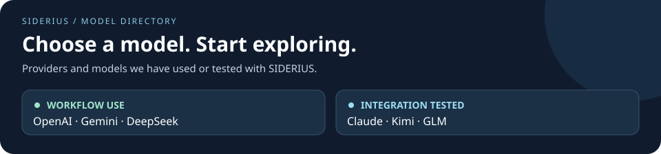

# Supported providers and models

  <a href="#at-a-glance">Provider overview</a> ·
  <a href="#qualification-records">Model records</a> ·
  <a href="#capabilities-to-qualify">Capability requirements</a> ·
  <a href="../getting-started/installation.md#api-keys">API keys &amp; setup</a>

Choose a provider, check the tested model, then expand its record for the exact
scope. Adapter support and model qualification are different: a basic smoke pass
is not a completed research workflow or evidence of scientific quality.

## At a glance

**Live checks: 2026-10-28** · Text, JSON and tool selection through `LLMBridge`.

| Provider | Recorded model | Text | JSON | Tool | Usage |
| --- | --- | :---: | :---: | :---: | :---: |
|  **OpenAI** | No record here yet | — | — | — | — |
|  **Gemini** | No record here yet | — | — | — | — |
|  **DeepSeek** | No record here yet | — | — | — | — |
|  **Claude** | `claude-sonnet-5-5` | ✅ | ✅ | ✅ | ✅ |
|  **Kimi** | `kimi-k3` | ✅ | ✅ | ↻ Pass | ✅ |
|  **GLM** | `glm-5.3` | ✅ | ✅ | ✅ | ✅ |

**Legend:** ✅ passed / usage recorded · **↻ Pass** succeeded on a separate retry
following HTTP 429 · **—** no qualification record in this page, not a failed test.
All six provider adapters are available. None of these records claims full-workflow
qualification. [View test settings and receipts →](model-qualification-evidence.md)

## Qualification records

The live smoke records below were observed on 2026-10-28. Their tested revision
and exact configuration are preserved in the linked evidence.

The [credential table](../getting-started/installation.md#api-keys) owns provider
identifiers and environment variable names. Anthropic, Moonshot and Z.AI need
an explicit model ID and the optional dependency described in
[additional-provider setup](../../src/agent/llm_transport/README.md).

Status terms used here:

- **Adapter available:** implemented route; no live model qualification implied.
- **Basic smoke passed:** the small text, JSON and tool checks below succeeded,
  with usage recorded. This is not full-workflow qualification.
- **Workflow qualified:** reserved for a recorded end-to-end run covering named
  roles, task, routing and budgets. None of the new records below has this status.

OpenAI — adapter available

Provider identifier: `openai`. No model-specific qualification record is included
in this document yet. Shipped routing profiles and historical experiments are
not automatically promoted to the three-path qualification defined here.

Google Gemini — adapter available

Provider identifier: `gemini`. No model-specific qualification record is included
here yet. Validate the exact model and assigned operations before a new campaign.

DeepSeek — adapter available

Provider identifier: `deepseek`. No model-specific qualification record is included
here yet. Validate the exact model and assigned operations before a new campaign.

Anthropic / Claude — claude-sonnet-5-5: basic smoke passed

| Model ID | Text | JSON | Tool selection | Usage | Endpoint |
| --- | --- | --- | --- | --- | --- |
| `claude-sonnet-5-5` | Pass | Pass | Pass | Recorded | `https://api.anthropic.com` |

Provider: `anthropic`. Three successful calls; no full workflow was run.
[Configuration and evidence](model-qualification-evidence.md).

Moonshot / Kimi — kimi-k3: basic smoke passed after retry

| Model ID | Text | JSON | Tool selection | Usage | Endpoint |
| --- | --- | --- | --- | --- | --- |
| `kimi-k3` | Pass | Pass | Pass after separate retry | Recorded | `https://api.moonshot.ai/v1` |

Provider: `moonshot`. The first tool call returned HTTP 429; the separate retry
succeeded. This does not establish sustained throughput. An initially miscopied
key returned 401; after correction, model listing succeeded. The older test ID
`kimi-k2.5` returned 404 and was absent from that account's model list; it is not
qualified here. These are dated observations, not universal availability claims.
[Configuration and evidence](model-qualification-evidence.md).

Z.AI / GLM — glm-5.3: basic smoke passed

| Model ID | Text | JSON | Tool selection | Usage | Endpoint |
| --- | --- | --- | --- | --- | --- |
| `glm-5.3` | Pass | Pass | Pass | Recorded | `https://api.z.ai/api/paas/v4` |

Provider: `zai`. Three successful calls; no full workflow was run.
[Configuration and evidence](model-qualification-evidence.md).

## Capabilities to qualify

Nodes use `LLMBridge`. Test through that gateway, not only through a vendor SDK.
A model needs the operations used by its assigned roles; a model intended for
all roles should pass all three output paths.

| Capability | What to verify |
| --- | --- |
| Text (`generate_text`) | Nonempty, complete output that follows the instruction. Reasoning and code-generation roles need this path. |
| JSON (`generate`) | A parseable object with the required fields and types, accepted by the downstream node schema. JSON-looking text alone is insufficient. |
| Tool selection (`tool_call`) | Exactly one declared tool, object arguments that meet its schema, and a nonempty call ID. Selecting a tool does not execute it. |
| Completion and limits | The chosen output ceiling accommodates the response; truncation or refusal must not be accepted as a complete result. Test representative prompt and output sizes. |
| Usage observability | Record requested and served model identities and available token counts. Missing usage is unknown, never measured zero. |
| Operational behavior | Check authentication, quotas, rate limits, timeouts and retry behavior for the intended workload. These can change independently of model capability. |

For Anthropic, JSON uses an output tool. Other optional providers use native
JSON-object output when their model profile supports it, otherwise the output
tool path. Tool support therefore matters even for some JSON-only roles.
The optional adapter is one-shot: these records do not establish streaming,
multi-turn thinking/tool continuation, multiple simultaneous tool calls, or
multimodal support. See the authoritative [transport contract](../../src/agent/llm_transport/transport-contract.md)
for request, response and accounting semantics.

## Add or refresh a qualification record

1. Bind only required credentials through the documented launch procedure.
   Record the provider, actual endpoint and exact model ID, never a secret.
2. Pin the framework revision and its locked dependencies. Record output limits,
   reasoning settings, timeouts and retries; a different configuration is a new
   qualification target.
3. Exercise text, JSON and single-tool selection through `LLMBridge`. Record
   acceptance checks and usage, including unsuccessful attempts and retries.
4. Before calling the model workflow-qualified, run its intended roles with
   representative schemas, code output, prompt sizes and budgets. Keep task
   configuration and scientific results in the experiment repository.
5. Add a dated row inside the provider's collapsed section and link sanitized
   evidence. Preserve earlier failures and state any untested operations.

Offline mocked tests establish adapter behavior, not live provider access.
Do not infer support for every model, endpoint, reasoning mode or workflow from
one passing smoke test. Recheck when any of those inputs changes.
